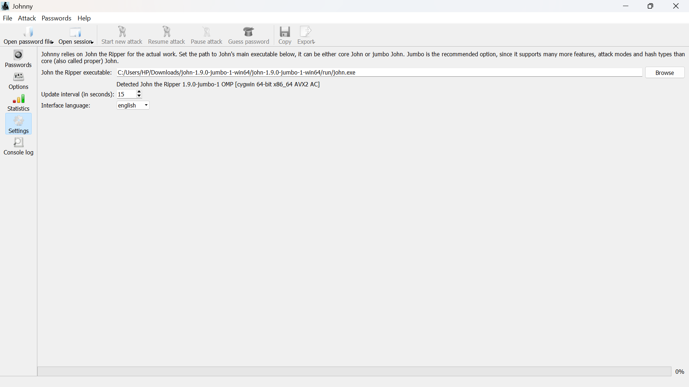
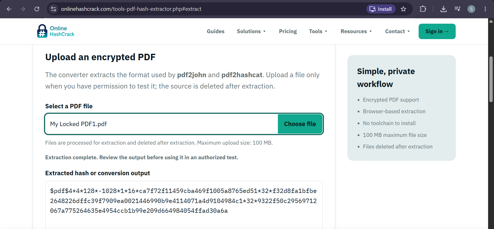
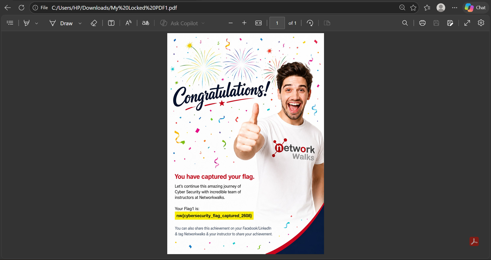
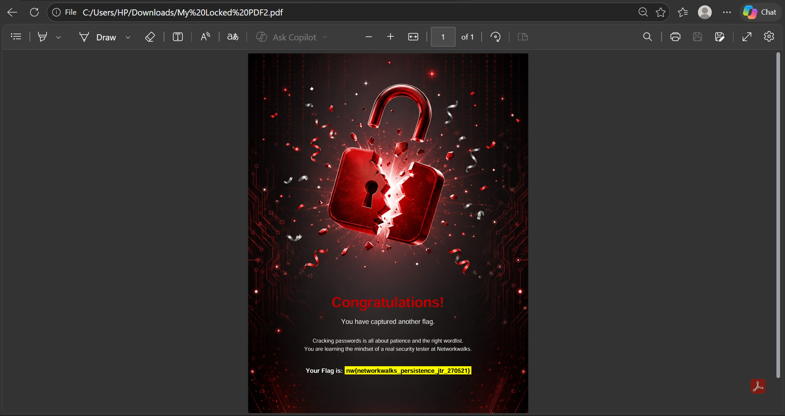
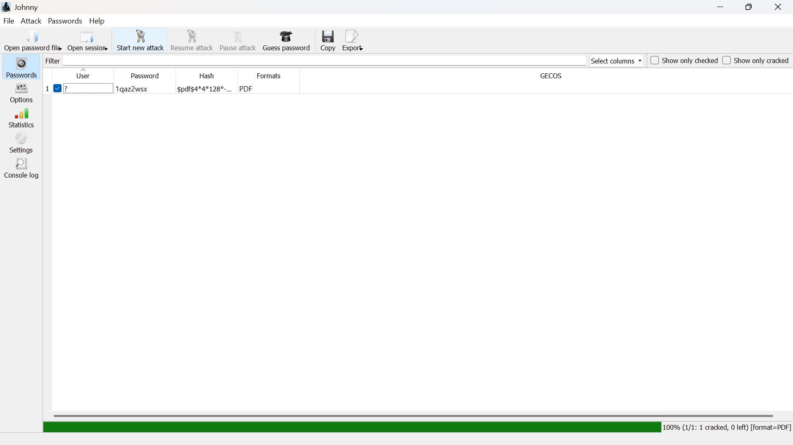
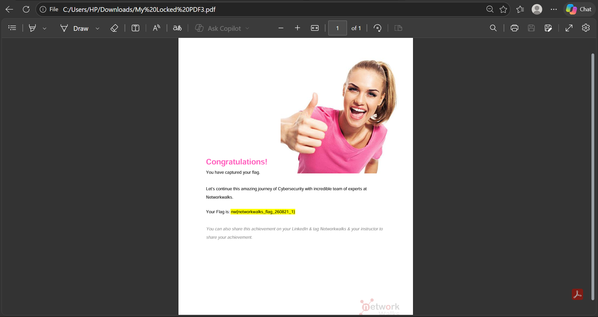

# PASSWORD CRACKING WITH JTR

**Week 3 | Project Module 1 | Cybersecurity & Ethical Hacking Internship**
Networkwalks

| Field | Detail |
|---|---|
| Name | Siyabonga Moyo |
| Program/Batch | B084 - Networkwalks |
| Date | 20 November 2026 |
| Module | W3-PM1 - Password Cracking with JTR |
| Tools | John the Ripper (JTR) 1.9.0-jumbo-1, Johnny 2.2 (GUI) |
| Target | 3 sample password-protected PDF files supplied for this exercise (`My Locked PDF1.pdf`, `PDF2`, `PDF3`) |

---

## 1. Disclaimer

These files were supplied by Networkwalks specifically for this learning exercise. No real, third-party, or production systems were tested. This report is for education and research purposes only.

## 2. Introduction

John the Ripper (JTR) is a password-cracking tool used to test password strength. **Johnny** is its graphical front end, so attacks can be run by clicking rather than typing long commands. This module covers recovering the password of a protected PDF file using JTR and Johnny on Windows.

Instead of guessing a PDF's password directly, the method works like this:
1. Extract the PDF's **hash** (a scrambled fingerprint of the password, not the password itself).
2. Hand that hash to John the Ripper / Johnny.
3. JTR tries candidate passwords from its built-in wordlist, scrambles each the same way the PDF does, and checks for a match.

The task required unlocking **three** supplied PDFs the same way.

## 3. Tools Used

| Tool | Purpose |
|---|---|
| John the Ripper (JTR) 1.9.0-jumbo-1, 64-bit Windows | The password-cracking engine |
| Johnny 2.2 | Graphical front end for JTR |
| Online Hash Extractor (onlinehashcrack.com) | Converts a protected PDF into a `$pdf$...` hash (pdf2john format) |
| Notepad | Used to save each extracted hash as a `.txt` file |

## 4. Activities Performed

1. Downloaded and installed JTR (64-bit Windows binaries) and Johnny (GUI).
2. In Johnny's **Settings**, pointed "John the Ripper executable" at `john.exe` inside the JTR `run` folder. Johnny confirmed: *Detected John the Ripper 1.9.0-jumbo-1 OMP [cygwin 64-bit x86_64 AVX2 AC]*.
3. For each of the three PDFs:
   - Uploaded the PDF to the online hash extractor and copied the resulting `$pdf$...` hash.
   - Saved the hash to its own text file (`hash1.txt`, `hash2.txt`, `hash3.txt`).
   - Opened that file in Johnny (**Open password file**) and ran **Start new attack**.
   - Recorded the cracked password and used it to open the PDF and capture its flag.

## 5. Evidence Collected

### 5.1 Johnny linked to John the Ripper

**What it shows:** Johnny's Settings tab after browsing to `john.exe`, confirming the executable was detected correctly.

### 5.2 Extracting a PDF's hash

**Command/action:** Uploaded `My Locked PDF1.pdf` to the online PDF hash extractor.
**Result:** A `$pdf$4*4*128*-1028*1*16*...` hash, saved to `hash1.txt` (the same method was repeated for PDF2 and PDF3, producing `hash2.txt` and `hash3.txt`).

### 5.3 PDF1 cracked

**Result:** Johnny reports `100% (1/1: 1 cracked, 0 left)`. Password: **`good-luck`**

**Flag captured:** `nw{cybersecurity_flag_captured_2608}`

### 5.4 PDF2 cracked

**Result:** Johnny reports `100% (1/1: 1 cracked, 0 left)`. Password: **`password1`**

**Flag captured:** `nw{networkwalks_persistence_jtr_270521}`

### 5.5 PDF3 cracked

**Result:** Johnny reports `100% (1/1: 1 cracked, 0 left)`. Password: **`1qaz2wsx`**

**Flag captured:** `nw{networkwalks_flag_260821_1}`

## 6. Results Summary

| File | Cracked Password | Password Pattern | Flag |
|---|---|---|---|
| My Locked PDF1.pdf | `good-luck` | Dictionary phrase | `nw{cybersecurity_flag_captured_2608}` |
| My Locked PDF2.pdf | `password1` | One of the most common passwords worldwide | `nw{networkwalks_persistence_jtr_270521}` |
| My Locked PDF3.pdf | `1qaz2wsx` | "Keyboard walk" (two adjacent keyboard columns) | `nw{networkwalks_flag_260821_1}` |

All three passwords cracked in well under a minute each. This is not a sign of a fast computer — it is a sign of weak, predictable passwords. All three fall into categories (dictionary words, top-common-password lists, and keyboard-pattern walks) that are the very first things a cracking wordlist tries.

## 7. Risk Analysis / Lessons Learned

| # | Observation | Why it matters | Recommendation |
|---|---|---|---|
| 1 | Dictionary-word passwords (`good-luck`) crack almost instantly | Any word or short phrase found in a dictionary or wordlist is not resistant to offline cracking | Avoid single dictionary words or common phrases, even with added punctuation |
| 2 | Top-common passwords (`password1`) crack first | Cracking wordlists are built from real breach data and try the most common passwords first | Never reuse well-known weak passwords; check new passwords against known-breach lists |
| 3 | Keyboard-walk passwords (`1qaz2wsx`) look complex but aren't | Mixing letters/numbers doesn't help if the pattern is a straight line on the keyboard | Use passphrases or a password manager to generate truly random passwords |
| 4 | Password length alone did not protect these files | All three passwords were 8-9 characters, within easy cracking range for weak patterns | Prioritise unpredictability over just length or character variety |

**Important:** this exercise used offline hash cracking against sample files provided for training. No systems, accounts, or files outside this authorized exercise were tested.

## 8. Conclusion

This module demonstrated, hands-on, why password strength is judged by unpredictability rather than length or apparent complexity. Using John the Ripper and its Johnny GUI, I extracted the hash from each protected PDF, ran an automatic cracking attack, and recovered all three passwords in seconds. The exercise reinforced a core security lesson: weak passwords (dictionary words, common passwords, and keyboard patterns) offer almost no real protection, however they are formatted.
